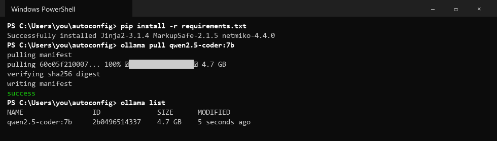
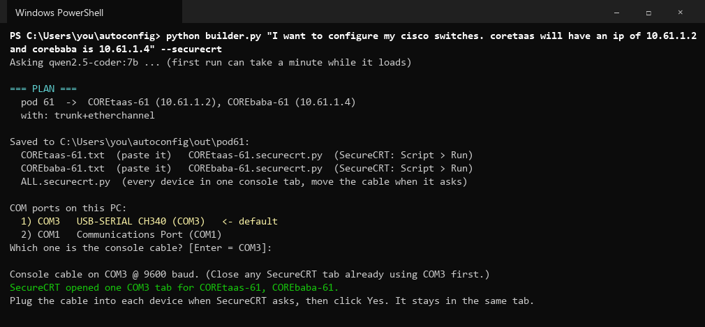
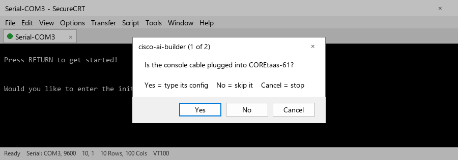
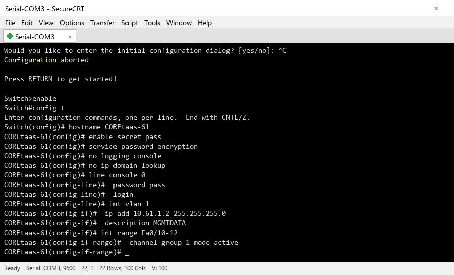
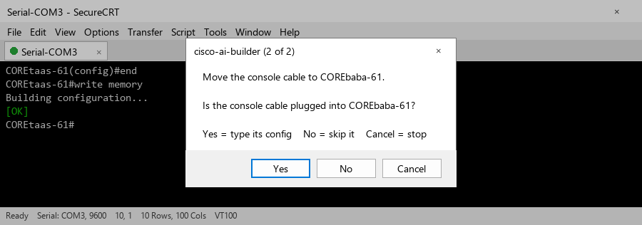
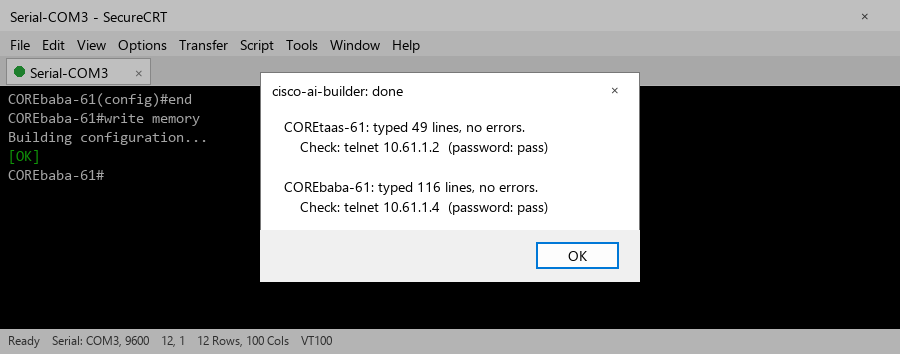
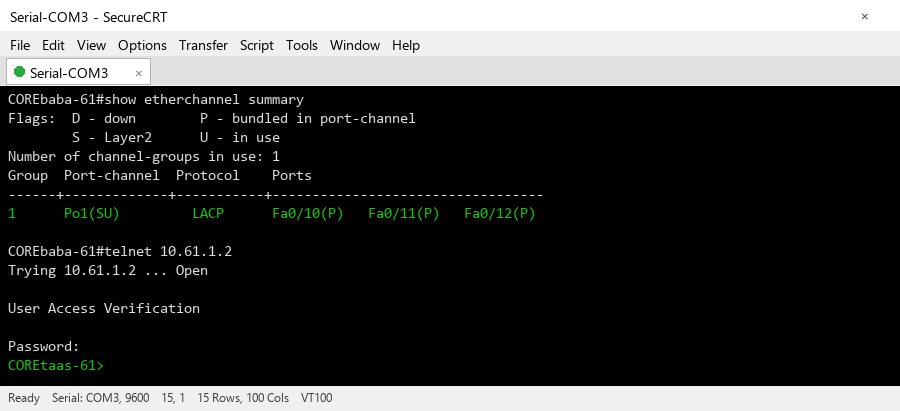

# autoconfig

Type what you want in plain English. Ollama (free, runs on your PC) reads it, the builder writes the lab configs, and SecureCRT types them into the switches over the console cable.

> The screenshots use pod **61** (`10.61.1.2`, `10.61.1.4`). Use your own number.

## Contents

- [Part 1: Setup](#part-1-setup)
- [Part 2: Commands](#part-2-commands)
- [Part 3: Results](#part-3-results)
- [All prompts](#all-prompts)
- [Troubleshooting](#troubleshooting)

---

## Part 1: Setup

You only do this once.

### Step 1: Install the programs

- [Python 3](https://www.python.org/downloads/) (tick **Add python.exe to PATH**)
- [Ollama](https://ollama.com/download)
- SecureCRT

### Step 2: Get the files

**Option A:** on GitHub click **Code > Download ZIP**, then extract it.

**Option B:**

```
git clone https://github.com/HayzeuMagic/autoconfig.git
```

### Step 3: Install the requirements and the AI model

Open PowerShell in the folder and run:

```
pip install -r requirements.txt
ollama pull qwen2.5-coder:7b
```



Any model works. If `qwen2.5-coder:7b` isn't there, the builder uses one you have (e.g. `llama3.2`).

---

## Part 2: Commands

### Step 1: Plug the console cable into COREtaas

### Step 2: Run your prompt with `--securecrt`

```
python builder.py "I want to configure my cisco switches. coretaas will have an ip of 10.61.1.2 and corebaba is 10.61.1.4" --securecrt
```

### Step 3: Pick the COM port

Press **Enter** for the default (the USB console cable), or type the number. It remembers your choice next time.



SecureCRT opens one **Serial-COM3** tab.

### Options

| Add this | What it does |
|---|---|
| `--securecrt` | Type the configs in over the console cable |
| `--com COM3` | Skip the COM port question |
| `--via telnet` | Type it over telnet (only after the switch has its IP) |
| `--check` | Test telnet to each switch afterwards |
| `--no-ai` | Skip Ollama, use the built-in rules (fast, switches only) |
| `--no-save` | Leave out `write memory` |
| `--model llama3.2` | Use another Ollama model |

No `--securecrt`? The configs are still saved in `out\pod61\`. Paste the `.txt`, or in SecureCRT use **Script > Run...** and pick `ALL.securecrt.py`.

---

## Part 3: Results

### Step 1: Click **Yes** when it asks for COREtaas



### Step 2: Let it type

It presses **Ctrl+C** at the setup dialog, goes to `enable`, then types one line at a time. Don't type while it runs.



### Step 3: Move the cable to COREbaba, click **Yes**

It stays in the same Serial-COM3 tab.



### Step 4: Read the summary

`no errors` means every line was accepted. Any rejected lines are listed here.



### Step 5: Check it

```
show etherchannel summary
show ip int brief
show vlan brief
telnet 10.61.1.2
```



| Login | Password |
|---|---|
| Console / telnet | `pass` |
| enable | `pass` |

---

## All prompts

Change `61` to your number. Add `--securecrt` to type it in.

| Prompt | Builds |
|---|---|
| `I want to configure my cisco switches. coretaas will have an ip of 10.61.1.2 and corebaba is 10.61.1.4` | TASK1 on both switches: SVIs, VLANs, trunk + LACP on Fa0/10-12, DHCP pools, access ports |
| `configure core taas 10.61.1.2 only` | COREtaas only |
| `configure my switches pod 61, coretaas is 10.m.1.2 and corebaba 10.m.1.4` | Same as the first one, using `m` |
| `... and corebaba is 10.61.1.4, no etherchannel` | Both switches without the trunk/LACP |
| `configure corebaba 10.61.1.4 with ip cameras at 10.61.50.6 mac 001a.2b3c.4d06 and 10.61.50.8 mac 001a.2b3c.4d08` | COREbaba + camera DHCP reservations |
| `... and block them from wifi` | Adds the ACL that blocks Wi-Fi from the cameras |
| `configure corebaba 10.61.1.4 with ospf, ssh, and a default route to the edge` | COREbaba + OSPF, SSH (`admin` / `pass`), default route |
| `set up the cucm for pod 61 with ip phones 6111 mac cafe.face.baba and 6122 mac fafa.caca.baba` | CUCM-61 + phones, and COREbaba |

**Everything at once:**

```
I want to configure my cisco switches. coretaas will have an ip of 10.61.1.2 and corebaba is 10.61.1.4 with ospf, ssh and a default route, cameras at 10.61.50.6 mac 001a.2b3c.4d06 and 10.61.50.8 mac 001a.2b3c.4d08, ip phones 6111 mac cafe.face.baba and 6122 mac fafa.caca.baba
```

**Not supported yet:** EDGE router, NAT, dial-peers, analog phones, IVR, SIP, Windows Server. See [PROMPTS.md](PROMPTS.md) for details.

---

## Troubleshooting

| Problem | Fix |
|---|---|
| Wrong COM port | Check **Device Manager > Ports (COM & LPT)**, then add `--com COM3` |
| "COM3 is in use" | Close the other SecureCRT tab using COM3 |
| `Can't reach Ollama` | Open the Ollama app. It still builds the switches without it |
| `SecureCRT.exe not found` | Put its path in `lab_defaults.json` under `securecrt.exe` |
| `wrong password` in the summary | The switch has an old password. Erase it (`write erase`, `reload`) and run again |
| `ROMMON` in the summary | Type `boot` on the switch, then run again |
| Telnet doesn't connect | Your PC must be in VLAN 1 (`10.61.1.x`). Check `show etherchannel summary` |
| `% Invalid input` on `encapsulation dot1q` | Normal on a 2960, ignore it |
